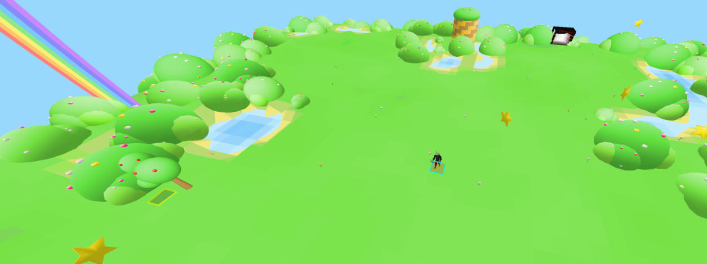
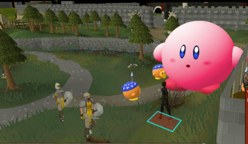

# Kirby Jad

A RuneLite plugin that turns the Fight Caves into Kirby's Dreamland. Client-side only, nobody
else sees it.

- **Jad is Kirby**: fire breath for mage, stone drop for range, a slap for melee, and a victory
  dance when he dies
- **Healers are Bandana Waddle Dees**, and the waves are Bronto Burts, Scarfies, Gordos, Waddle
  Doos and Meta Knights
- **Dreamland caves**: grass, water, hedges, hills, mesas, Whispy Woods, butterflies and a rainbow
- **Colour brightness** slider for normal screens and recordings

## Installing

Grab `kirby-jad-*.jar` from [Releases](../../releases) and sideload it with your preferred method.
Built against RuneLite 1.13.2.

## Building

- `run-test.bat` starts the locally built client (`..\runelite`) with the plugin loaded.
- `render-preview.bat` renders all animations to `build\preview\*.png` without the client.
